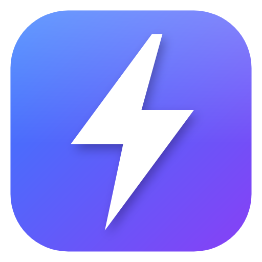
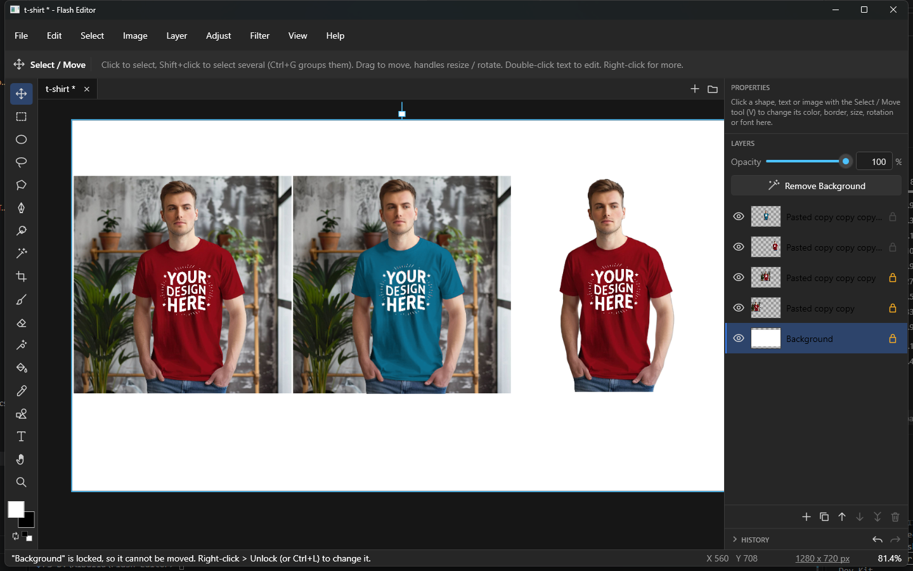
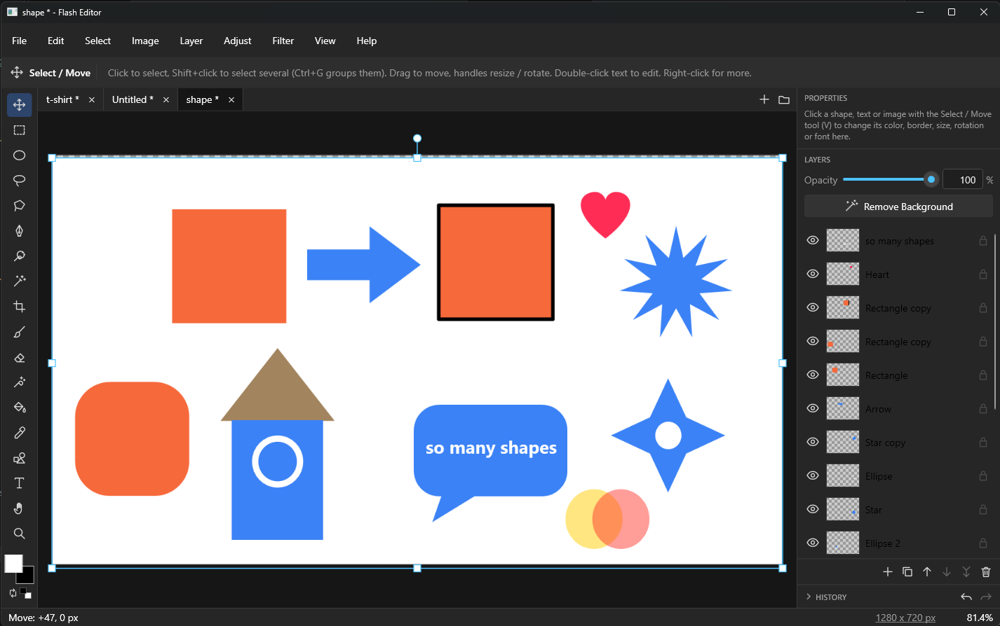

<p align="center"></p>

# Flash Editor

A Photoshop-style image editor for Windows with Canva-style editable objects and built-in AI tools.
Written in **C# / .NET 10 / WPF**. AI runs on your PC (no internet, no account), on the graphics card when there is one.

---

## Highlights

| | |
|---|---|
| **AI Remove Background** | One click keeps the person / product and removes the rest, even busy backgrounds. A **Refine brush** paints back or takes away anything the AI got wrong. |
| **AI Remove / Fill** | Select an object (a person, a logo, a blemish) and the AI paints in what would be behind it, on a new layer. Works offline. |
| **Recolor** | Change the color of a dress or T-shirt with a color graph. Folds, shadows and highlights are kept, so fabric still looks real. |
| **Editable objects** | Shapes, text and placed pictures stay editable (like Canva): click to select, drag the handles to resize or rotate, change colors and fonts any time. |
| **AI Upscale / Clean Up** | Makes small or blurry pictures sharper, or 2x to 4x larger with real-looking detail (Real-ESRGAN). |
| **Selections** | Rectangle, ellipse, lasso, polygon lasso, pen (curves), magic wand, quick-select brush, AI "Select Subject". |
| **Export** | Pick format, quality and size, crop to 1:1 / 4:5 / 16:9..., and see the real file size before saving. |

---

## Screenshots

### Change a T-shirt color, keeping the fabric's shading
Select the shirt (Magic Wand or Quick Select), then **Adjust > Recolor**. Tip: remove the background first, so the selection cannot spill into the background.



### Editable shapes and text
Speech bubble, text and a rotated star, each on its own layer. The **Properties** panel changes fill, border, corners, points, rotation, font and size, with a number box next to every slider.




## Features

### Files and pictures
* Open **PNG, JPG, WEBP, ICO, BMP, GIF, TIFF, JPEG XR, DDS** and, when Windows has the free codec from the Microsoft Store, **HEIC, AVIF, JPEG XL and camera RAW** (DNG, CR2, NEF, ARW...). Drag files onto the window; hold **Ctrl** while dropping to add them as layers.
* **Save** (Ctrl+S) keeps your work as a **project** (a `.flash` file): every page and layer, shape, text, picture, group, shadow, 3D look, gradient and guide line stays editable, so you can close the program and carry on later. Open it again with **Open** (Ctrl+O) or by dragging it onto the window.
* **Export** (Ctrl+Alt+S) makes a normal picture: **PNG, JPG, WEBP, ICO** (16 to 256 px), **BMP**, **TIFF** or **GIF** (256 colors, with smart color reduction), with format, quality, output size and crop.
* **Several pictures at once**, one tab each, with their own layers, undo history and zoom. Double-click a tab to rename it.
* **One undo history per project**: all pages of a project share it, so Ctrl+Z takes back the newest change of the project whichever page it was made in (that page is shown), including a deleted page. The History panel lists the steps of the whole project. It keeps **30 steps** by default; **Settings > Undo Steps...** changes that (1 to 60; more steps need more memory). Open projects use the new number at once.
* **Project Manager**: Flash Editor starts with the Project Manager, which shows all your projects as cards with a picture, the number of pages and the date. Double-click a card to open it, use the search box to find one, or press **New project** to create one with a name, a size (Instagram, YouTube, A4...) and a ready-made layout. New projects are saved at once in `Documents\Flash Editor Projects` (you can pick another folder); projects you open or save from other folders are listed too. Right-click a card to rename it, show it in Explorer, remove it from the list, or delete it (to the Recycle Bin). Open it again any time with **File > Project Manager** or the **Projects** button left of the project tabs.
* **Projects and pages**: the tabs along the top are your **projects**; the strip at the bottom of the canvas lists the **pages** of the selected project only (with a **+ Page** button). **Add Page** (Ctrl+Alt+N) adds an empty page after the current one; **Duplicate Page** (right-click a page) copies it with everything editable. All pages of a project are saved together in one `.flash` file. Double-click a project or page to rename it; the cross on a project tab closes the whole project (Ctrl+W), the cross on a page closes just that page. **Export All Pages** writes one picture per page (`name-1.png`, `name-2.png`...).
* **Crash protection**: unsaved work is backed up in the background every minute. If the program ever closes unexpectedly, it offers to bring your work back the next time you start it.
* **New picture templates**: File > New has sizes for Instagram, YouTube, Facebook, X, LinkedIn, Pinterest, A4/A5/Letter, business cards and posters, and a **Start from** list of ready-made layouts (Title slide, Quote card, Sale poster, Photo with caption, Announcement) whose text and shapes you can change.

### AI tools (offline, GPU accelerated)
* **Remove Background** (button in the Layers panel, Ctrl+Alt+B). Sliders for edge sharpness, shrink / grow and feather, with live preview. The result is an **editable picture object**: move, resize, rotate it, give it a **shadow**, and click through its removed (transparent) parts to what lies behind. It remembers the original picture, so it can always be refined.
* **Refine brush (R)**: *Restore* paints back what was removed by mistake, *Remove* takes away leftovers. Alt = the other mode. It paints on the picture itself, so it keeps working after the cut-out was moved, resized, rotated or mirrored, and the shadow follows the new edge. Works on any placed picture too.
* **Select Subject**: selects the main person or object in one click.
* **Remove / Fill Selection (AI)** (Image menu, Shift+F5, or right-click): select what you want gone with the Lasso (L), Rectangle (M), Magic Wand (W) or Select Subject, include a bit of its shadow, and run it. The AI fills the area with what would plausibly be there and puts the result on a new layer called **AI Fill**, so the original is never changed (hide the layer to compare, Ctrl+Z to undo). It takes a few seconds (the first time a little longer while the model loads) and works best on backgrounds such as sky, grass, walls and floors; very large areas come out a little soft, so fill them in parts. It does not draw new things from a text prompt.
* **AI Upscale / Clean Up**: same size but sharper, or 2x / 3x / 4x larger. Shows progress and time left, with Cancel.
* Runs on any DirectX 12 graphics card (NVIDIA, AMD, Intel) through DirectML, otherwise on the processor. Example: cleaning up a 1536 x 1024 picture takes about 25 s on an Intel Arc A750 instead of about 6 min on the processor.

### Editable objects (Canva-style)
* **Shapes** (Insert > Shape; there is no Shapes tool any more): 36 shapes in groups, each shown with a small picture: rectangle, ellipse, triangle, right triangle, star, polygon, pentagon, hexagon, octagon, sparkle, burst, diamond, trapezoid, parallelogram, heart, arrow, double arrow, chevron, tag, home, cross, check, X mark, lightning bolt, cloud, teardrop, shield, speech bubble, oval bubble, line, and ring, half ring, half circle, quarter circle, pie, crescent, frame. A click adds the shape in the middle of the picture; resize it with the handles and set fill, border, corners and the special settings (points, hole size, angle) in Properties.
* **Reshape corners**: select any object (shape, picture, text, group) and click **Reshape corners** in the Properties panel, then drag its round corner points, inward or outward: a square becomes a trapezium, a star point can be pulled out, a picture or text gets a perspective. Shapes with straight sides move their own corners; other objects move the four corners of their box. Shift = coarser steps, Esc finishes, **Reset** brings back the normal form. One undo step per drag.
* **Text (T)**: any installed font, size, bold, italic, alignment, color. Double-click to edit.
* Placed and pasted pictures are resizable without losing quality.
* Click to select, drag handles to resize, round handle to rotate (Shift = 15° steps). **Shift+click** or **Ctrl+drag a box** selects several; **Ctrl+G** groups, **Ctrl+Shift+G** ungroups, **Ctrl+D** duplicates.
* **Lock** (Ctrl+L or the padlock) prevents moving and editing. A locked object cannot be picked by clicking on the canvas (clicks go through it); select it in the Layers panel to unlock it. Bring to front / back, flip, crop one object, convert to pixels.

### Painting and selecting
* Brush, eraser, paint bucket, eyedropper, foreground / background colors with an HSV color picker. **Brush types** (pick in the tool options, each with a preview): round, square, calligraphy, pencil, chalk, spray, splatter.
* **Retouching tools**: **Clone Stamp (S)** (Alt+click the place to copy from, then paint; *Aligned* keeps the distance between strokes), **Spot Healing (J)** (paint over a blemish, it is healed from a clean place the program finds), **Healing Brush (J)** (like Clone Stamp, but the copied detail takes on the light and color of its new place), **Patch (J)** (draw around a blemish, drag the outline onto a clean area), **Dodge / Burn (O)** (lighten or darken shadows, midtones or highlights; Alt = the other one) and **Blur / Sharpen (Q)** (Alt = the other one). J switches between Spot Healing, Healing Brush and Patch. They paint on pixels (a placed picture is turned into pixels first; **Make editable** brings it back). One undo step per stroke; a selection limits the effect.
* **Shadow size**: the **Size** slider of a shadow makes it smaller (below 100 %) or bigger (above 100 %) than the object, around the middle of the object.* **3D look**: tick **3D look** in the Properties panel to give any shape, text, picture or group a solid side (a block or 3D-letter look) and lit / shaded edges on its face. Pick a preset (Block, Long, Pop, Floor, Left) or set **Depth**, **Angle**, **Edges** (bevel strength) and the side color (automatic = the object's own color, darker). The side follows the real outline, works together with shadows and keeps its direction when the object is turned.
* **Quick merge**: select two or more layers (Ctrl+click in the Layers panel, Shift+click or Ctrl+drag on the canvas) and press **Merge** in the Layers panel, **Ctrl+E**, Layer > Merge Selected Layers, or right-click > Merge N Layers. They become one layer where the top one was, with each layer's opacity kept; hidden and locked layers in the selection are left alone. One undo step. (With one layer selected Ctrl+E still merges it down. Use **Group**, Ctrl+G, to keep objects editable.)
* **Tool groups**: similar tools share one button in the toolbox (like Photoshop). A small triangle in the button corner means more tools: click the triangle (or right-click the button) to open the list and pick one; the button then shows it. Groups: rectangle / ellipse select, lasso / polygon lasso, quick select / magic wand, brush / eraser / refine, spot healing / healing brush / patch.* **Rulers, grid, guides and snapping**: toggle buttons above the canvas (also in the View menu). **Rulers** (Ctrl+R) show pixel units; drag from a ruler onto the picture to make a **guide line**, drag a guide with Select / Move to move it, drag it back onto the ruler to remove it. **Grid** (Ctrl+') with a size you choose. **Snapping** (Ctrl+Shift+;) makes objects, pictures, new shapes and selections click into place against other objects (edges and centers), the canvas edges and center, the grid and the guides, with pink smart-guide lines. **Equal spacing** (like Canva): when you drag an object it also snaps so its gap to a neighbor equals the gaps between other objects in the same row or column, or sits exactly in the middle between two objects, and the gaps are shown in pixels. Hold **Alt** to move without snapping. The settings are remembered.
* Selection tools: rectangle, ellipse, lasso, polygon lasso, **pen (curves)**, magic wand, **quick-select brush**, select subject (AI), select layer content. **Shift** adds, **Alt** subtracts. The program starts with **Select / Move** active.
* Move the selected pixels, copy, cut, paste, delete, fill, invert. Nothing is cut off at the canvas edge; **Image > Reveal All** shows parts moved outside.

### Layers and history
* Add, duplicate, delete, reorder, show / hide, lock, opacity, rename, merge down, flatten. **Select all**, **Lock all** and **Unlock all** buttons act on the selected layers (Ctrl+A with the Select / Move tool also selects every layer).
* **Every layer has the same Properties**: a layer of plain pixels (painted) also shows Position, Size, Rotate, Turn, Flip, Align and the effects (shadow, glow, outline, 3D...). The first time you change one of them, the layer is turned into a movable picture automatically (a separate Ctrl+Z step brings it back to pixels). Painting on a picture or shape turns it into pixels automatically too, so there are no "Make editable" or "To pixels" buttons.
* **Groups show their parts** (like Canva): a grouped layer has an arrow to open or close the list of its parts, each with a small picture and its name (double-click to rename).
* **Edit inside a group** (like Canva): double-click a group, or click one of its parts in the Layers panel, to select just that part. Move, resize, rotate, recolor, change text, add a shadow or delete it (Delete) while it stays in the group. **Esc** goes back to the whole group. All undoable.
* **Gradient colors**: tick **Gradient** (Properties) to fill a shape or color a text with a fade through **two to eight colors**. Click a color to change it, drag its slider to move it along the gradient, **+ Add color** for another one, the cross removes one, **Reverse** flips the direction. Or pick one of eleven ready-made looks (Sunset, Ocean, Forest, Candy, Fire, Night, Gold, Glow, Rainbow, Aurora, Sunrise). Set the **Angle**, or tick **Radial** to fade from the middle outward. The gradient turns and mirrors with the object and works together with shadows and 3D.
* **More gradient places**: **Also on the border** puts the gradient on a shape's border; on a picture the gradient is a see-through **overlay** (Dark at the bottom, Vignette, Warm tint...) with an **Opacity** slider for every color. **Layer > Add Gradient Background** puts a gradient behind everything.
* **Styles**: **Save this look...** (Properties > Styles) stores the shadow, 3D look, gradient and colors of an object under a name. Click it later to put the same look on another object (right-click it to delete). Saved looks are there in every project.
* **Align and distribute**: Layer > Align (also in the right-click menu) lines up the selected layers left, center, right, top, middle or bottom (one layer aligns to the canvas, several align to each other) and **Distribute** spreads three or more with equal gaps. One undo step.
* **Blend modes**: the **Blend** list in the Layers panel (Multiply, Screen, Overlay, Soft light, Hard light, Darken, Lighten, Difference) changes how a layer mixes with the ones below. You see it live while you work.
* **Adjustment layers**: **Layer > Add Adjustment Layer** changes brightness, contrast, saturation and hue of everything below it without touching any picture. Tune it any time, hide it, or delete it. Merge Down bakes it into the layer below.
* **Text**: **Outline** (color and width) and **Lines** spacing in the Properties panel.
* **Drop shadow** on any shape, text, picture or group (Properties > Shadow): color, opacity, blur, distance and angle. The shadow follows the real outline of the object. Ten one-click presets, each shown as a small picture of the shadow: Soft, Hard, Lifted, Subtle, Contact, Sticker, Long, Glow, Neon and Left.
* **Drag layers up and down** in the Layers panel to change their order (drag one of several selected layers to move them all). A line shows where the layer will land; one undo step.
* Layer icons are redrawn when you finish a change (a moment after you let go of the mouse), not while you drag, which keeps moving objects smooth.
* New shapes, text and pictures are always added in front of everything else.
* Undo / redo for everything, plus a History panel (click a step to jump back). Undo keeps at most 60 steps and about 1 GB of memory, so editing a very large picture many times cannot use up your RAM (the oldest steps are forgotten first).
* The window opens full screen the first time, then reopens with the size, position and maximized state you left it in (saved in `settings\window.json` next to `FlashEditor.exe`).

### Image
* Image Size / Resolution with 4 resize methods (Lanczos, Bicubic, Bilinear, Nearest) and quick % buttons.
* Canvas Size with anchor, Crop tool (whole picture or one object; 1:1, 4:5, 9:16, 16:9, 3:2, 4:3), Trim, rotate (90°, 180°, any angle), flip.
* **Split Asset Sheet**: select the items (or let it find them), then split into separate layers and / or transparent PNG files.

### Adjustments and filters (all with live preview)
* **Adjust:** Recolor, Auto Levels, Brightness / Contrast, Exposure / Gamma, Hue / Saturation, Vibrance, Temperature / Tint, Grayscale, Invert, Sepia, Posterize, Threshold.
* **Filter:** AI Clean Up, Enhance (no AI), Gaussian Blur, Motion Blur, Sharpen, Reduce Noise, Add Noise, Pixelate, Vignette, Emboss, Find Edges.
* With an active selection they only change the selected area.

### More tools
* **Layer masks**: Layer > Layer Mask adds a mask to a layer. Paint with the **Mask Brush (K)**: black hides, white shows, grey is half way (X swaps colors). The pixels are never changed, so hidden parts can always come back. Masks are saved in projects.
* **Levels and Curves adjustment layers**: Layer > Add Adjustment Layer. Curves has a draggable curve per channel; Levels has black, white and gamma points. Both are non-destructive.
* **Effects** (Properties panel): **Glow**, **Inner shadow** and **Outline**, next to the existing shadow and 3D look.
* **Text designs**: select a text and open **Properties > Text > Designs** for 16 ready-made looks (Clean, Impact, Neon Pink, Neon Blue, Retro 3D, Sticker, Sunset, Ocean, Gold, Fire, Elegant, Script, Comic, Long Shadow, Letterpress, Terminal), each shown as a small picture. One click sets the font, color or gradient and the effects; the words, place and size stay, and the effects scale with the text size. One undo step.
* **Text on a curve**: the **Curve** setting of a text bends it along an arc.
* **Straighten** and **Perspective Crop** (Image menu): straighten a tilted horizon, or use Perspective Crop to flatten a sheet or sign: drag a box over it, drag the four corners onto the real corners (drag inside to move the box), then press Enter. The flattened part becomes a new layer, the original layer is hidden (not changed) and the canvas keeps its size.
* **Liquify (Q group)**: push, pull and smooth parts of a picture with the brush.
* **Remove Brush (AI)** (J group): paint over something, let go, and the AI fills it in on a new "AI Fill" layer (same model as Remove / Fill Selection).
* **Click Select (AI)** (W group): click an object and the AI selects just that object, or drag a box around it. Shift adds, Alt subtracts. It uses MobileSAM (two small files, about 44 MB together, MIT/Apache licensed, from huggingface.co/Acly/MobileSAM), downloaded once after you say yes (Settings > AI Models lists and removes them). The first click on a picture takes a few seconds while the AI studies it; more clicks on the same picture are almost instant. It runs on the processor, because the graphics-card version gave wrong outlines.
* **Crop (C)** works like a selection tool: drag a box over the picture, then adjust it with the mouse (corners and edges resize it, dragging inside moves it, dragging outside draws a new one). Choose a shape (Square, 16:9...) if you want, then press **Enter**. The part inside the box becomes a **new layer** and the original layer is **hidden, not changed** (show it again with the eye icon). The canvas is never resized (use Image > Canvas Size for that). Esc cancels.
* **Colors**: the color picker keeps your **recent colors** and **swatches** (saved in `settings\app.json`).
* **File > Export** holds every way to export in one submenu (it opens when the mouse rests on it): picture (Ctrl+Alt+S), ready-made sizes, all pages as pictures, PDF, animated GIF, SVG and Photoshop file.
* **Export For** (File > Export): ready-made sizes and quality for Instagram, YouTube, print and more, for one page or all pages.
* **Photoshop files**: open `.psd` (layers, opacity, blend modes) and **Export as Photoshop File** with layers. Objects, text and effects become pictures in Photoshop; adjustment layers are left out. Tested with hand-built files only, not with Photoshop itself.
* **SVG**: **Export as SVG** keeps plain shapes and text as vectors (anything with effects becomes an embedded picture). Opening an `.svg` reads rectangles, circles, ellipses, lines, polygons, paths (curves are flattened, arcs become straight lines), text and embedded pictures as editable objects. Gradients, filters and clipping in SVG files are not supported.
* **Ribbon**: the menu bar at the top is a ribbon with the tabs Edit, Select, Image, Layer, Insert, Adjust, Filter, View and Settings; each shows its commands as buttons in groups. **File** is a button at the left end: it opens a drawer that slides in from the left (new, open, save, pages, every export, exit; Esc or a click outside closes it). Insert goes in the order new layer, image (place image, frame, photo grid), shape (the twelve most used shapes are right there, **Shapes** opens all of them), chart, then QR code and barcode. Buttons with a small triangle open a list. Double-click a tab, or use the arrow at the right end, to hide or show the buttons. Help (tour, shortcuts, about) is in the View tab.
* **Right-click menu** (with icons): lock, group, merge, align (several layers), cut / copy / paste, duplicate, **Split to New Layer** (with a selection: the selected part moves onto a new layer like Cut, the original stays visible without it), delete, order, **Rotate 90° Right / Left**, flip, recolor, AI tools and **Fill Selection (AI)**. **Align to canvas**, rotate buttons, Original size and To pixels are in the Properties panel.
* **Right-click a layer in the Layers panel** for quick layer options: show / hide, lock, rename, duplicate, group, merge, order, layer mask, rotate, flip and delete.
* **Properties > Adjust**: brightness, contrast, saturation, hue and blur for any object or picture layer, live, with no dialog (the shadow and other looks are not changed). **Reset** clears it.
* **Bent lines**: a line has a **Bend** slider and a Curve choice (an arc that bows once, or an S-shaped wave); **Edit as curve** turns it into a curve with points that you can bend in many places with the Curve tool. Arrow heads follow the bend. **Keep proportions** (the link button in Transform) now decides how the corner handles resize: on keeps the shape's ratio, off lets it change, and Shift does the opposite.
* **Line style**: borders and lines can be **solid, dashed or dotted**, with their own **Dash** length and **Gap** sliders; lines can have an **arrow head** at either end (Properties > Shape).
* **Insert menu**:
  * **QR Code**: type a web address or any text; the code stays editable (text, repair level, colors, squares / rounded / dots, border) and sharp at any size. Made by the program itself (checked against an independent QR library and a QR decoder).
  * **Barcode**: Code 128 (any text), EAN-13, UPC-A and EAN-8 (shop codes: the check digit is added or checked for you) and Code 39. The text, type, colors and the numbers under the bars stay editable, and a wrong text says what is wrong. EAN-13, UPC-A and EAN-8 are made by the program itself and were checked with a barcode reader; Code 128 and Code 39 were checked against the rules of their standards only, so test those with a scanner before printing.
  * **Chart**: Columns, Bars, Line, Pie or Donut. Properties has type buttons, a table of numbers (name, number and its own color per row, add / remove rows, or paste a whole list), ready-made color sets (and your Brand Kit), options for numbers, names and grid lines, a unit before / after the numbers (for example $ or %), bar width, text size, text color and background.
  * **Frame** and **Photo Grid**: add empty frames (rectangle, rounded, circle, heart, star) or a collage layout (10 layouts, with gap, border and corners). Select the frames and choose **Fill Frames**: each picture covers its frame and is clipped to its shape. The picture is part of the frame, so moving, resizing, turning or copying the frame takes the picture along. Properties > **Picture in frame** has Zoom, Left / right, Up / down (which part shows), Center and fit, and Remove picture.
* **Curve tool (P, in the Pen group)**: draw shapes and lines made of Bezier curves. Click = corner, click and drag = smooth curve, click the first point to close a shape (it gets a fill), Enter / double-click to end a line. Select a curve to edit it: drag points and handles (Alt bends one side), double-click a point to make it smooth or sharp, double-click the line to add a point, Delete removes the selected point. A curve is a normal shape, so fill, border, dashes, gradient and shadow work. Double-click a curve with the Select tool to edit its points.
* **Magic Resize** (Image menu): turns a design into another size (a post into a story) and keeps the layout: objects keep their proportions and relative place, text scales, a full-size background covers the new canvas; optionally for every page of the project.
* **Several layers selected**: a change in Properties (shadow, glow, outline, 3D, adjust, rotate, flip...) goes to every selected layer as one undo step. Settings that only fit one kind of object (the Text and Text designs sections, or the Shape section) show only when all selected layers are of that kind, so a text and a shape together get only the common settings. Position, size, the words of a text, Reshape and Save this look need a single layer. Locked layers are left unchanged.
* **Align section** (Properties): a 3 x 3 grid of squares moves the layer to a corner, an edge or the middle of the canvas in one click (like the anchor presets of game editors), and two rows line it up along one direction only. With several layers selected they line up with each other. **Styles** (saved looks) now live in the Transform section, next to **Save this look...**.
* **Text spacing**: **Letter gap**, **Word gap** and **Line gap** sliders (Properties > Text); they also work on curved text, where several lines follow concentric arcs. Reshape corners and Save this look are in the Transform section.
* **Clip to Layer Below** (Layer > Layer Mask, or right-click a layer): the layer shows only inside the shape of the layer under it, for example a photo inside a shape or text. It makes a mask from the shape as it is now; the layer's pixels are not changed.
* **Export as PDF** (all pages, one PDF page each, JPEG pictures, choose quality and dpi) and **Export as Animated GIF** (every page is a frame; choose the time per page and looping). Both in File > Export.
* **Batch Convert Folder** (File menu): turns every picture of a folder into another format and / or a smaller size (never enlarged, never overwriting; subfolders optional).
* **Save as Template** (File menu) keeps the current picture, fully editable, as a starting point: it appears in File > New under **Start from**, marked with a star (saved in `settings	emplates`).
* **Brand Kit** (Settings menu): up to 12 colors (they come first in every color picker; "Add colors from this picture" finds the main colors of your picture) and 3 fonts (quick buttons when a text is selected).
* **Keyboard Shortcuts** (Settings tab, or F1): every shortcut of every command and tool in one list. Click a shortcut and press the new keys (commands need Ctrl or Alt, tools use one key); Backspace removes a shortcut, the arrow button brings the normal one back, Reset all restores everything. If you give a key that another command has, that command loses it. Saved in the settings folder.
* **Quick Tour** (Help menu, also shown the first time you start the program).
* **Settings** menu: undo steps, AI models (download or remove), and more.

Press **F1** in the app for all keyboard shortcuts.

---

## Install

Download one of the two installers (Windows 10 / 11, 64-bit; no .NET needed):

| Installer | Size | AI tools |
|---|---|---|
| `FlashEditor-Setup-1.0.0.exe` (Standard) | 60 MB | During setup you can tick the AI models to download now (about 470 MB in total, checked with SHA-256); anything you skip is offered the first time you use that tool, or in Settings > AI Models |
| `FlashEditor-Setup-1.0.0-AI.exe` | 489 MB | All AI models included (background removal, fill, upscaling, click select), ready offline |

**Everything is installed in one folder** (default `C:\Program Files\Flash Editor`): the program, all libraries, the .NET runtime and the AI models (`models\`). Nothing is written to AppData or anywhere else. Uninstall (Settings > Apps, or the Start-menu shortcut) removes the whole folder, including models downloaded later. Installing one edition over the other upgrades in place.

### Build the installers

Needs the .NET 10 SDK and [Inno Setup 6](https://jrsoftware.org/isinfo.php) (`winget install JRSoftware.InnoSetup`), and the AI models in the Debug build's `models` folder (use the AI tools once in a Debug run, or pass `-ModelsFrom`):

```bash
powershell -ExecutionPolicy Bypass -File installer\build-installers.ps1 -Version 1.0.0
```

Both installers end up in `installer\output`. The script is `installer\build-installers.ps1`, the installer definition `installer\FlashEditor.iss`.

## Getting started (developers)

You need Windows 10 / 11 and the **.NET 10 SDK**.

```bash
dotnet run --project src/FlashEditor.App
```

Run the tests:

```bash
dotnet test
```

Build a stand-alone app in `publish/`:

```bash
dotnet publish src/FlashEditor.App -c Release -r win-x64 --self-contained false -o publish
```

### AI models

The models are **not** in the repository (they are large). The app downloads each one the first time you use it, after asking:

| Model | Used for | Download | License |
|---|---|---|---|
| IS-Net general use (from the rembg project) | Remove Background, Select Subject | 170 MB | Apache 2.0 |
| LaMa big-lama (ONNX by Carve) | Remove / Fill Selection | 198 MB | Apache 2.0 |
| Real-ESRGAN x4plus (ONNX build from Qualcomm AI Hub) | AI Upscale / Clean Up | 62 MB | BSD-3 |

Files are checked (size and SHA-256) before use and saved only in the `models` folder next to `FlashEditor.exe`. After that everything works offline. When copying the app to another PC, copy the whole folder.

**Settings > AI Models...** lists every model with what it is for, whether it is on this PC and how much space it uses, and has **Download** and **Delete** buttons for each one (and a **Show folder** button). Deleting a model frees its disk space; the features that need it ask to download it again the next time you use them.

---

## Keyboard shortcuts (most used)

| Keys | Action |
|---|---|
| V / M / L / P / W | Select & move / rectangle-ellipse select / lasso / pen / quick select-magic wand |
| B / E / R / G / I | Brush / eraser / refine (restore-remove) / bucket / eyedropper |
| S / J / O / Q | Clone stamp / healing tools (press again to switch: spot, brush, patch) / dodge-burn / blur-sharpen |
| Ctrl+R / Ctrl+' / Ctrl+; / Ctrl+Shift+; | Rulers / grid / guides / snapping |
| U / T / C / H / Z | Shapes / text / crop / hand / zoom |
| Ctrl+Z, Ctrl+Y | Undo, redo |
| Ctrl+C, Ctrl+X, Ctrl+V | Copy, cut, paste |
| Ctrl+Shift+D, Ctrl+Shift+I | Deselect, invert selection |
| Ctrl+D | Duplicate layer / object |
| Ctrl+G, Ctrl+Shift+G | Group, ungroup |
| Ctrl+L | Lock / unlock |
| Ctrl+Alt+B | Remove background (AI) |
| Ctrl+Shift+R | Recolor |
| Ctrl+S / Ctrl+Shift+S | Save project (.flash) / save project as |
| Ctrl+Alt+S | Export as a picture (PNG, JPG...) |
| Ctrl+Alt+N | Add a page |
| Ctrl+Tab, Ctrl+W | Next picture, close picture |
| Space + drag, mouse wheel | Pan, zoom |

---

## Project structure

Four projects, many small files with one job each:

```
Flash Editor/
├── FlashEditor.slnx                 Solution file
├── docs/screenshots/                Pictures used in this README
├── installer/                       Installer script (Inno Setup) + build-installers.ps1
├── src/
│   ├── FlashEditor.Core/            The image engine. No UI code, unit-tested.
│   │   ├── Imaging/                 PixelBuffer, colors, rectangles, blending math
│   │   ├── Documents/               Document, Layer, LayerState, LayerCrop
│   │   ├── Objects/                 Shape / Text / Image / Group objects, ObjectBox, transforms
│   │   ├── Selections/              Selection masks, polygon rasterizer, outline tracer, quick select
│   │   ├── Sheets/                  Asset sheet splitter
│   │   ├── History/                 Undo / redo manager and one class per kind of undo step
│   │   ├── Painting/                Brush strokes (paint, erase, restore), flood fill, compositing
│   │   ├── Retouch/                 Clone, heal, spot heal, patch, dodge/burn, blur/sharpen operations
│   │   ├── Transforms/              Crop, flip, rotate, resize (Lanczos, Bicubic...)
│   │   ├── Effects/                 Effect framework, Adjustments/, Filters/, Background/
│   │   └── IO/                      Decoder, encoder (PNG/JPG/WebP/ICO/BMP/GIF), exporter; TIFF and unusual formats through Windows codecs; `Project/` reads and writes .flash projects
│   │
│   ├── FlashEditor.AI/              AI features (ONNX Runtime + DirectML). Kept out of Core.
│   │   ├── Models/                  Which model, where from; download once and verify
│   │   ├── Runtime/                 Opens models on the GPU, falls back to the CPU
│   │   ├── Segmentation/            Subject finder (background removal, select subject)
│   │   ├── Upscaling/               Real-ESRGAN in overlapping tiles, blended without seams
│   │   └── Effects/                 AI background removal effect
│   │
│   └── FlashEditor.App/             The Windows app (WPF, MVVM)
│       ├── Assets/                  App icon (.ico for Windows, .png for docs)
│       ├── Themes/                  Colors, icons, styles
│       ├── Rendering/               Bitmaps, vector / text rasterizer, object renderer
│       ├── Services/                Dialogs, clipboard, live effect preview
│       ├── ViewModels/              Screen state; Commands/ has one class per menu
│       ├── Tools/                   One class per tool (Painting/, Selecting/, Shapes/, Text/...)
│       └── Views/                   Main window, canvas, panels, dialogs, reusable controls
└── tests/
    └── FlashEditor.Core.Tests/      xUnit tests (engine + AI helpers; real-model tests run when installed)
```

### How it fits together

* **Core vs App.** All image processing lives in `FlashEditor.Core`, which knows nothing about windows, so it is easy to test and the UI stays thin.
* **MVVM.** Views bind to view models; view models call into the Core and open windows only through `IDialogService`.
* **Pixels.** A layer's pixels are always canvas-sized. Content moved past the edge is kept in a hidden, larger buffer, so nothing is ever cut off.
* **Objects.** An object layer stores a small immutable description (shape, text, image, group) and its pixels are just a drawing of it. Undo only stores the before / after descriptions.
* **Undo.** Every change pushes one `IHistoryAction` after it is applied (pixel changes store only the changed rectangle).
* **Extending.** A new tool is one `ToolBase` class; a new filter is one `ImageEffect` class. The dialog, live preview, selection masking and undo come for free.

---

## Notes and limits

* Saving merges all visible layers into one picture; there is no layered project file yet.
* JPG has no transparency: transparent areas are filled with the background color.
* AI background removal keeps the *main* subject. When it gets a part wrong, fix it with the Refine brush (R).
* AI upscaling makes believable detail but cannot recover detail that was never there (e.g. a tiny face).
* The first AI run after starting the app takes a few extra seconds while the model is prepared for the graphics card.
